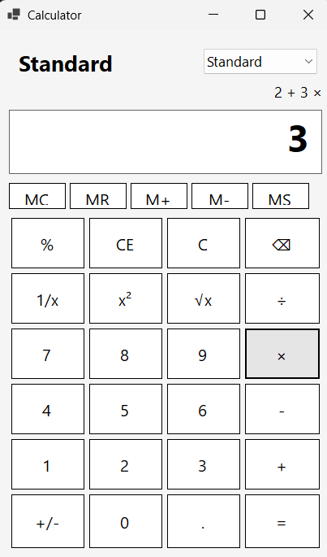
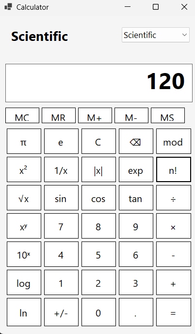

# Calculator (Windows Forms)

A desktop calculator with a standard and a scientific mode, written in C# with Windows Forms on .NET 8. The whole interface is built in code at runtime, and the buttons are rebuilt when you switch modes.

## Screenshots

| Standard | Scientific |
|---|---|
|  |  |

## Features

**Standard mode**
- Addition, subtraction, multiplication and division with correct operator precedence (`2 + 3 × 4 =` gives 14) and chained operations (`10 - 4 - 3 =` gives 3)
- A small line above the display shows the calculation so far (for example `2 + 3 ×`)
- Percent, reciprocal (`1/x`), square (`x²`), square root (`√x`)
- Sign toggle (`+/-`), decimal point, clear entry (`CE`), clear all (`C`), backspace (`⌫`)

**Scientific mode** adds
- `π`, `e`, modulo (`mod`), absolute value (`|x|`), `exp` (eˣ), factorial (`n!`), power (`xʸ`), `10ˣ`, `log` (base 10) and `ln`
- Powers are right-associative, as in mathematics (`2 xʸ 3 xʸ 2 =` gives 512) and bind tighter than `×` and `÷`
- `sin`, `cos` and `tan`, with angles in **degrees**

**Memory:** `MC`, `MR`, `MS`, `M+`, `M-`

**Error handling:** division by zero, modulo by zero, square root of a negative number, `log`/`ln` of zero or a negative number, factorial of a negative or non-integer number or of a number above 170, and `tan` at 90° all show `Error` instead of crashing.

## Requirements

- Windows 10 or 11
- [.NET 8 SDK](https://dotnet.microsoft.com/download/dotnet/8.0) or Visual Studio 2022 with the ".NET desktop development" workload

## Build and run

With Visual Studio: open `Calculator.sln` and press F5.

From a terminal:

```bash
dotnet run --project Calculator.csproj
```

## How it works

- `BuildDynamicGui()` creates the display, mode selector, memory row and button grid in code, using `TableLayoutPanel` layouts.
- Choosing a mode in the drop-down calls `BuildStandardButtons()` or `BuildScientificButtons()`, which clear the grid and add the button set from a 2D array of labels.
- All buttons share one click handler that reads the button text and dispatches to the matching operation with a `switch`.
- Pending calculations are kept as two lists, one of operands and one of operators. When a new operator is pressed, earlier operators that bind at least as tightly are applied first (a small version of the shunting-yard idea), and `=` applies whatever is left. This gives correct precedence without parsing a full expression string.
- Other state: the memory value, and flags for whether the next digit starts a new number and whether the last key was an operator (so pressing a second operator replaces the first).
- Numbers are held as `double` and displayed with `G15` formatting and the invariant culture, so the decimal separator is always `.`.
- Trigonometric results are rounded to 12 decimal places to remove floating-point noise (for example, `sin(180°)` shows `0`).

## Project structure

| File | Purpose |
|---|---|
| `Program.cs` | Application entry point |
| `Form1.cs` | Interface construction, calculator state and all operations |
| `Form1.Designer.cs` | Window settings (title, size, start position) |
| `Calculator.csproj` | Project file (`net8.0-windows`, Windows Forms) |

## Limitations

- Arithmetic uses `double`, so values are limited to about 15 significant digits, and some very large results (for example `exp` of a large number) display as `Infinity`.
- No keyboard input yet; use the on-screen buttons.
- Trigonometric functions work in degrees only.